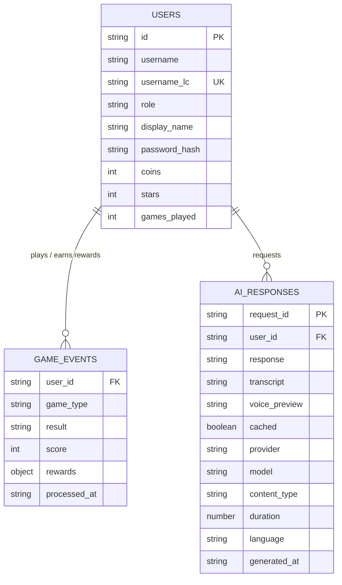

# Aubit ER Diagram

This ER diagram is based on the current backend persistence code in `backend/app/db/repositories.py`, `backend/app/db/mongo.py`, `backend/app/services/game_service.py`, and `backend/app/services/ai_service.py`.



## Relationship Notes

- `USERS.id` is the logical primary key for user profiles.
- `USERS.username_lc` is unique and used for case-insensitive login lookup.
- `GAME_EVENTS.user_id` points to `USERS.id`. A user can have many game result events.
- `AI_RESPONSES.user_id` points to `USERS.id`. A user can have many saved AI prompt or transcription responses.
- `AI_RESPONSES.request_id` is unique and identifies each saved AI response or transcription request.

## MongoDB Indexes

```text
users.id unique
users.username_lc unique
ai_responses.request_id unique
ai_responses.user_id
game_events.user_id
game_events.user_id + game_events.processed_at descending
```
